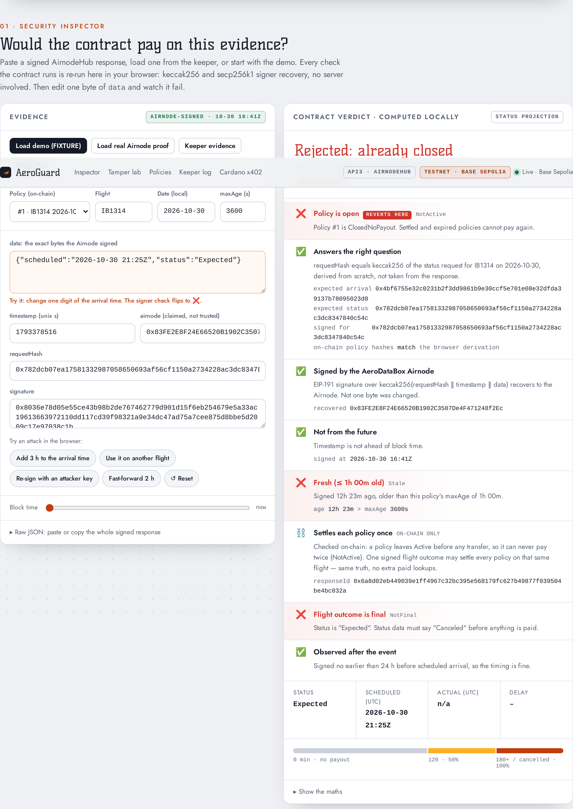
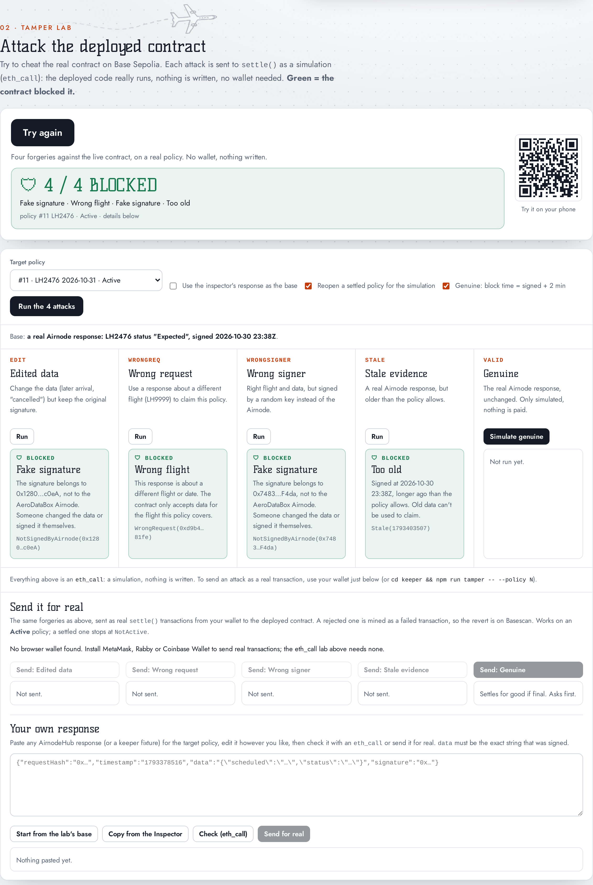
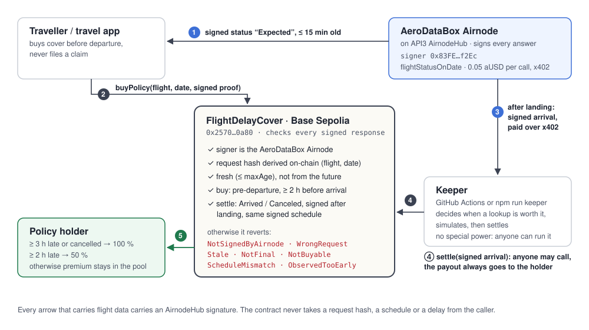

# AeroGuard — your flight is late, you're already paid

[](https://github.com/womp-maindev/aeroguard/actions/workflows/ci.yml) [](https://github.com/womp-maindev/aeroguard/actions/workflows/keeper.yml)

| Security Inspector: the real AirnodeHub-signed proof for policy #1, checked in the browser | Tamper lab: 4 forgeries, 4 reverts |
|---|---|
| [](docs/img/inspector.png) | [](docs/img/tamper-lab.png) |
| Signer recovers to the AeroDataBox Airnode, the request hash matches IB1314 on 30 Oct, and the evidence is rejected as `Stale(1793378516)` / `NotFinal(Expected)`: the same answer the live contract gave. | Captured on the local anvil rehearsal (`npm run rehearse`, fixture signer). The page header names Base Sepolia, but these reverts are local; the live results are in the [tamper table](#tamper-test-for-judges). |

Parametric flight-delay cover that settles itself. A smart contract pays out **only** on flight data signed by the **AeroDataBox Airnode on API3 AirnodeHub**, and an autonomous keeper buys that data over **x402** and settles policies on-chain without anyone filing a claim.

## Judge quickstart (3 min)

**1 · What is live (30 s).** Every line links to its evidence.

| Claim | Evidence |
|---|---|
| Contract deployed on Base Sepolia, source verified | [`0x2570…0a80` on Basescan](https://sepolia.basescan.org/address/0x257054204c4Cd43846C4553eBe6D709841980a80) |
| The keeper pays for signed AeroDataBox data over x402 (0.05 aUSD per call) | [payment tx 0x76d334da…](https://sepolia.basescan.org/tx/0x76d334da55c86bbf61d37762f8ee843f4920bc874477a82d06852247b4e2054f) |
| Cover can only be bought with a fresh signed pre-departure status | [policy #1 purchase tx](https://sepolia.basescan.org/tx/0xbfd3ae73074ff63a3ef5f7e56b211d1ffb7223e2db944d0cc38ed069d1958b8d), with [its signed proof](keeper/fixtures/IB1314-status-proof.json) paid in [tx 0x544a7241…](https://sepolia.basescan.org/tx/0x544a72416958438be7181af6dc96111ea7d0e6544d63e7ac869faac28671dad2) |
| 4 real policies on real flights of 30 Oct 2026 | [#1](https://sepolia.basescan.org/tx/0xbfd3ae73074ff63a3ef5f7e56b211d1ffb7223e2db944d0cc38ed069d1958b8d) · [#2](https://sepolia.basescan.org/tx/0x7e71c55b970b96fb1588ddde1da029060d805c9b87691280ca2504098d4e69d2) · [#3](https://sepolia.basescan.org/tx/0x2aeed6010ced165f66c26ea0f34e7068421a327cac0c6375d72ef7b794f41672) · [#4](https://sepolia.basescan.org/tx/0x7e675d8f94946db1d02a40c1eff87ac5a0ca29b65730751cf0d902d767d2b0d1) |
| Nobody files a claim: a keeper buys the outcome and settles them | [keeper runs in GitHub Actions](https://github.com/womp-maindev/aeroguard/actions/workflows/keeper.yml) · settlement txs: see [Live evidence](#live-evidence-base-sepolia-real-aerodatabox-data) |

**2 · Why the oracle data is load-bearing (60 s).** The contract decides the payout from signed fields only, so each forgery has its own revert. All of these are Foundry tests:

| Forgery | Rejected with | Test |
|---|---|---|
| one signed value edited | `NotSignedByAirnode` | [`Tamper1_RejectEditedValue`](contracts/test/FlightDelayCover.t.sol#L129) |
| genuine but too old | `Stale` | [`Tamper2_RejectTooOld`](contracts/test/FlightDelayCover.t.sol#L140) |
| genuine, but for another flight / date / projection | `WrongRequest` | [`Tamper3_RejectOtherRequest`](contracts/test/FlightDelayCover.t.sol#L151) |
| signed by any other key | `NotSignedByAirnode` | [`Tamper4_RejectUnexpectedSigner`](contracts/test/FlightDelayCover.t.sol#L162) |
| cover bought for a flight already delayed / landed | `NotBuyable` | [`Buy_RejectOutcomeAlreadyKnown`](contracts/test/FlightDelayCover.t.sol#L287) |
| on-chain request hash ≠ AirnodeHub's | — | [`RequestHashMatchesAirnodeHubScheme`](contracts/test/FlightDelayCover.t.sol#L82) · [`Fixture_RealAeroDataBoxCapture`](contracts/test/Fixtures.t.sol#L105) (real Airnode signature) |
| all 4 live policies replayed on their **real** Airnode signatures (real `buyPolicy` + `settle`, no test signer; proofs read back from the purchase calldata) | `NotFinal(Expected)`, `Stale(1793378516)` as on-chain | [`LiveReplay.t.sol`](contracts/test/LiveReplay.t.sol) |

The same forgeries were also run against the **deployed** contract with a real Airnode response: see the [tamper table](#tamper-test-for-judges).

**3 · Run it yourself (90 s, no keys, no funds).**
```bash
git clone --recurse-submodules https://github.com/womp-maindev/aeroguard && cd aeroguard
cd contracts && forge test                       # 86 tests, incl. all 4 live policies replayed, purchase to settlement, on their real Airnode signatures
cd ../keeper && npm ci && npm test
anvil --chain-id 84532 & npm run rehearse        # local deploy, 5 signed purchases, 4 attacks + valid, keeper settles all
```

| | |
|---|---|
| Contract (Base Sepolia) | [`0x257054204c4Cd43846C4553eBe6D709841980a80`](https://sepolia.basescan.org/address/0x257054204c4Cd43846C4553eBe6D709841980a80) · source verified on Sourcify |
| Trusted signer | AeroDataBox Airnode `0x83FE2E8F24E66520B1902C3507De4F471248f2Ec` |
| Data operation | `flightStatusOnDate` (0.05 aUSD per call, x402) |
| Payment token | aUSD `0xbeA34973e5f67F18F656A2C6070C64326C791808` |

## Live evidence (Base Sepolia, real AeroDataBox data)
Every policy, signed response and x402 payment in one place: [docs/EVIDENCE.md](docs/EVIDENCE.md).
Pitch day: policies #5–#11 on Saturday flights (LH1866, LH2472, EI352, LH1810 in the morning; LH1868, LH2476, LH1814 landing around and after judging) were bought at 23:28–23:38Z with signed pre-departure proofs. The keeper settles them from 09:40Z, some live during judging; see [EVIDENCE](docs/EVIDENCE.md).

| Step | Tx |
|---|---|
| x402 payment for a signed AeroDataBox response (0.05 aUSD) | [0x76d334da…](https://sepolia.basescan.org/tx/0x76d334da55c86bbf61d37762f8ee843f4920bc874477a82d06852247b4e2054f) |
| Policy #1 IB1314 MUC→MAD, bought with a signed pre-departure proof | [0xbfd3ae73…](https://sepolia.basescan.org/tx/0xbfd3ae73074ff63a3ef5f7e56b211d1ffb7223e2db944d0cc38ed069d1958b8d) |
| Policy #2 LH1816 MUC→BCN | [0x7e71c55b…](https://sepolia.basescan.org/tx/0x7e71c55b970b96fb1588ddde1da029060d805c9b87691280ca2504098d4e69d2) |
| Policy #3 EI357 MUC→DUB | [0x2aeed601…](https://sepolia.basescan.org/tx/0x2aeed6010ced165f66c26ea0f34e7068421a327cac0c6375d72ef7b794f41672) |
| Policy #4 BA955 MUC→LHR | [0x7e675d8f…](https://sepolia.basescan.org/tx/0x7e675d8f94946db1d02a40c1eff87ac5a0ca29b65730751cf0d902d767d2b0d1) |
| **Settled by the keeper:** #1 IB1314 landed 21:00Z, 25 min early → `ClosedNoPayout` (premium stays in the pool), on the Airnode-signed "Arrived" ([x402 0xaaa74d0e…](https://sepolia.basescan.org/tx/0xaaa74d0e408f5558f14e71f43b7a37b6e37764d454d0425291f7dfb7b36e2104)); replayed in [`test_Live_IB1314_SettlesLikeOnChain`](contracts/test/LiveReplay.t.sol) | [0xf0aa5db2…](https://sepolia.basescan.org/tx/0xf0aa5db2e08a9b9aa7298c92853642b39d7ff330fe3e42cd8b441aa136246b44) |
| **Settled by the keeper:** #2 LH1816 landed 22:06Z, 11 min late → `ClosedNoPayout` ([x402 0x557e5d5b…](https://sepolia.basescan.org/tx/0x557e5d5b3d60626c9d23593fada9d43c81de82e5f6e02b8663336f6a03635156)); replayed in [`test_Live_LH1816_SettlesLikeOnChain`](contracts/test/LiveReplay.t.sol) | [0x5270aa58…](https://sepolia.basescan.org/tx/0x5270aa58d63db79af041e74bb40115a801381f28caca028d90c285280594c535) |
| **Settled by the keeper:** #3 EI357 landed 21:26Z, 29 min early → `ClosedNoPayout` ([x402 0x856458f5…](https://sepolia.basescan.org/tx/0x856458f50e565ae958ecc5ec385bd01b954f28daf20be41daa07b342bea24e15)); replayed in [`test_Live_EI357_SettlesLikeOnChain`](contracts/test/LiveReplay.t.sol) | [0x5a5e4fc7…](https://sepolia.basescan.org/tx/0x5a5e4fc750464b0f4043aa2318da55705ae0eb94603adf17d417068de4f2ff9a) |
| **Settled by the keeper:** #4 BA955 landed 21:47Z, 3 min early → `ClosedNoPayout` ([x402 0x764671bf…](https://sepolia.basescan.org/tx/0x764671bfb440405891e8190fe99168cded5f51acaede70273ce5b4fa18bbc8c3)); replayed in [`test_Live_BA955_SettlesLikeOnChain`](contracts/test/LiveReplay.t.sol) | [0x973e29d8…](https://sepolia.basescan.org/tx/0x973e29d8195ce6bfe7bde0b749b308cfe1e8200e2465c849810a0a01dd01c7ee) |

Tamper test against the deployed contract with a REAL signed Airnode response (policy #1): edited value → `NotSignedByAirnode`, other flight → `WrongRequest`, attacker key → `NotSignedByAirnode`, genuine but older than `maxAge` → `Stale(1793378516)`, genuine but pre-departure → `NotFinal(Expected)`. A captured real response (`contracts/test/fixtures/aerodatabox-arrival.json`, LH400) is verified in Solidity by `test_Fixture_RealAeroDataBoxCapture`: the on-chain request-hash derivation matches AirnodeHub byte for byte.
The keeper is scheduled in GitHub Actions ([`.github/workflows/keeper.yml`](https://github.com/womp-maindev/aeroguard/actions/workflows/keeper.yml), every ~15 min) to settle these policies after landing. On 30 Oct the schedule did not fire until it was re-registered, so the first runs were started by hand (`workflow_dispatch`); every run, scheduled or manual, is listed [here](https://github.com/womp-maindev/aeroguard/actions/workflows/keeper.yml). GitHub runs schedules on a best-effort basis: they can be late or skipped, and the keeper does not depend on them, since anyone can run `npm run keeper` or call `settle`.

## The problem
Flight delays are common and compensation claims are slow: forms, evidence, weeks of waiting, often a claims-agency fee. Parametric cover removes the claim: if trustworthy data says the flight landed late, money moves. The hard parts are **trusting the data** and **who presses the button**. AeroGuard answers both: AirnodeHub signatures checked by the contract, and a keeper that anyone can replace because it has no special power.

## How it works


The detailed map, with the components, the signed payload, the purchase, settlement and verification flows, the money flows and the trust boundaries, is in [docs/ARCHITECTURE.md](docs/ARCHITECTURE.md).

```
Traveller / travel app
  │ 1  buy: attach a fresh signed AeroDataBox STATUS response (pre-departure)        → buyPolicy
  ▼
FlightDelayCover.sol (Base Sepolia)
  ✓ purchase: signer · request (derived on-chain from flight+date) · ≤15 min old · status pre-departure
              · scheduled arrival read FROM the signature · ≥ minLeadTime away
  ✓ settle:   signer · request · fresh (≤ maxAge) · not from the future · status final
              · observed after the landing it reports · same signed schedule as at purchase · policy still Active
  → ≥180 min late or cancelled: 100% · ≥120 min: 50% · otherwise closed, premium stays in the pool
  ▲
  │ 2  keeper (keeper/): after scheduled arrival buys a SIGNED arrival response via x402 and calls settle
  │    anyone can call settle — money always goes to the stored holder
```

### Why the signed data matters (API3)
The payout decision **is** the verified flight status. Remove AirnodeHub and there is nothing the contract could safely pay on: anyone could claim "my flight was 4 h late". Because the contract computes the request hash itself from `flight` + `date` (mirroring AirnodeHub's `keccak256(JSON.stringify([operation, sortedParams, sortedProjection]))`), not even the agent that sold the policy can settle it with data about another flight, another day or another projection.

Two projections per policy keep the signed payload tiny and cover both outcomes:
- **arrival**: `{actual: /0/arrival/revisedTime/utc, scheduled: /0/arrival/scheduledTime/utc, status: /0/status}`
- **status**: `{scheduled, status}`: a cancelled flight has no revised time (the Airnode answers 400 for a missing pointer), so cancellations are proven with this one.

**Who relies on the data:** travellers and the travel agents/bots that resell cover; LPs who fund the pool.
**If it were forged:** the pool is drained by fake "4 h late" claims, or honest travellers are denied payment.
**Trust assumptions:** the signature proves the AeroDataBox Airnode returned exactly this at this time. It does not prove AeroDataBox is right about the real world. We pick a recognised aviation source and require a final status.
**Data we wanted but couldn't find on AirnodeHub:** a second source of scheduled *and* actual arrival times for 2-of-2 agreement (OpenSky, on AirnodeHub, tracks aircraft but has no schedules), a first-party flight-status Airnode, EU261 eligibility (delay cause, extraordinary circumstances), route and airport delay statistics (AeroDataBox has them, its listing doesn't serve them), airline compensation records, and strike, closure and NOTAM feeds. Details: [docs/DEVFOLIO.md](docs/DEVFOLIO.md#data-we-wanted-but-couldnt-find-on-airnodehub).

### Signed data at BOTH ends — no adverse selection
Buying cover also needs AirnodeHub-signed evidence. `buyPolicy` takes a fresh (≤15 min) signed AeroDataBox **status** response for that exact flight+date: the contract checks signer + request + freshness, accepts only pre-departure statuses (`Expected / Unknown / CheckIn / Boarding`), reads the scheduled arrival **from the signature** and requires it to be ≥ `minLeadTime` away. Nobody can insure a flight that is already late, and nobody can lie about its schedule; settlement must show the exact same signed schedule.

### Private policies (commit–reveal)
`buyPrivatePolicy(commitment, …)` stores only `keccak256(abi.encode(flight, date, salt))`. Observers can't tell which flight is insured until `settlePrivate` reveals it, then the same verification runs. Residual risk (documented): without a purchase proof a private buyer is bounded only by lead time and a ±1 h schedule window; production fix = ZK proof of purchase-time status.

### Autonomous keeper (API3 bonus)
`npm run keeper` runs unattended (the GitHub Actions schedule in `.github/workflows/keeper.yml` runs one pass every ~15 min, best-effort). It reads active policies from chain, decides **when** data is worth buying ([`schedule.ts`](keeper/src/schedule.ts), tested in [`schedule.test.ts`](keeper/src/schedule.test.ts): one early look 3 h before arrival for cancellations, then every 30 min from 30 min after the scheduled arrival until +6 h, then every 3 h until +24 h, at most 20 paid lookups per policy because the AeroDataBox quota is shared; any run, cron or manual, decides from chain + saved state), pays through x402, simulates `settle`, and only then sends the transaction. One signed outcome settles every policy on the same flight. State = chain + cache, so it survives restarts. Every Actions run publishes its log and every AirnodeHub-signed response it holds to [`keeper-data/keeper.json`](https://github.com/womp-maindev/aeroguard/blob/keeper-data/keeper.json): anyone can re-verify them, and the dashboard's tamper lab uses them as genuine bases.

## Tamper test for judges
```bash
cp .env.example .env            # set KEEPER_PK (Base Sepolia ETH) and FLIGHT_COVER_ADDRESS
cd keeper && npm i
npm run tamper -- --policy 1                          # edit · stale · wrongreq · wrongsigner · valid
npm run tamper -- --policy 1 --response my.json       # YOUR OWN signed response
npm run tamper -- --policy 1 --mode edit --response my.json
```
Each forgery is simulated (`eth_call`, no transaction) against the deployed contract and prints the revert reason. The right column is what the **live** contract answered for policy #1, starting from the real AirnodeHub-signed [`IB1314-status-proof.json`](keeper/fixtures/IB1314-status-proof.json) (signed 30 Oct 2026 16:41:56 UTC):

| Attack | Contract answer | Live result, policy #1 (30 Oct 2026) |
|---|---|---|
| one value edited | `NotSignedByAirnode(<random signer>)` | ✅ rejected: `NotSignedByAirnode` |
| response too old | `Stale(timestamp)` | ✅ rejected: `Stale(1793378516)` (genuine signature, older than the policy's 1 h `maxAge`) |
| response to a different request | `WrongRequest(hash)` | ✅ rejected: `WrongRequest` |
| signed by an unexpected key | `NotSignedByAirnode(attacker)` | ✅ rejected: `NotSignedByAirnode(attacker)` |
| genuine, fresh, but not final | `NotFinal(status)` | ✅ rejected: `NotFinal(Expected)` |
| valid, fresh, final | ✅ `Settled` → payout | settlement txs in [Live evidence](#live-evidence-base-sepolia-real-aerodatabox-data) |

Once a policy is settled, the contract answers `NotActive` before any oracle check. The dashboard's tamper lab can still run the four forgeries on it (browser `eth_call` with a state override that reopens the policy for that call only, no key); `npm run tamper` needs an `Active` policy.

### In the browser, as real transactions from your wallet
The dashboard's tamper lab ends with **Send it for real** ([`web/wallet.js`](web/wallet.js)). It sends the same forgeries, or your own response, as real `settle()` transactions to the deployed contract. A rejected one is mined as a failed transaction, so the revert is on Basescan, not just in a simulation.

1. Open the dashboard and scroll to **02 · Tamper lab → Send it for real**. **Connect wallet** (MetaMask, Rabby or Coinbase Wallet). The button switches you to Base Sepolia, and adds it to the wallet if needed. A few cents of Base Sepolia ETH pays for gas; the panel links to the [Base faucets](https://docs.base.org/get-started/get-funds) if the wallet has too little.
2. Pick an **Active** policy as the target. A settled policy would stop every transaction at `NotActive`, so the panel refuses it and points to the `eth_call` lab above, which can reopen it.
3. Press **Send** on an attack. The wallet may warn that the transaction will fail: for an attack that is the point, so confirm it. The panel shows the decoded revert, the plain-English reason and the Basescan link.
4. **Your own response:** paste any AirnodeHub response, keeper fixture or `npm run cli -- proof <buyPolicy tx>` output, edit it, then **Check** (an `eth_call`, no wallet needed) or **Send for real**. If the check says the contract would accept it, sending asks first, because it settles the policy for good. Anyone may settle; the payout always goes to the stored holder.

| What you send | On-chain answer |
|---|---|
| a real response with one value edited | `NotSignedByAirnode(<random signer>)` |
| a real response for another flight's request | `WrongRequest(hash)` |
| a response signed by a key that is not the Airnode's | `NotSignedByAirnode(attacker)` |
| a real response older than the policy's `maxAge` | `Stale(timestamp)` |
| a real, fresh, final response | `Settled` → payout to the holder |

**Tip for a real base:** a new policy's own signed purchase proof is in its `buyPolicy` calldata. `cd keeper && npm run cli -- proof <buyPolicy tx>` prints it, with no key and no paid lookup. Load it in the Inspector and tick **Use the inspector's response as the base**, so the edit, wrong-request and wrong-signer attacks start from a real Airnode signature. Once it is more than an hour old, sent unmodified it shows `Stale`.

Also rejected: buying after departure (`NotBuyable`), buying too close to arrival (`TooCloseToArrival`), schedule switched after purchase (`ScheduleMismatch`), settling twice (`NotActive`), future timestamps (`FromTheFuture`), "Arrived" signed before the landing it reports (`ObservedTooEarly`), non‑final status (`NotFinal`), selling cover the pool can't back (`Insolvent`).

## Run it
Node ≥ 22.18 and [Foundry](https://getfoundry.sh).
```bash
git clone --recurse-submodules https://github.com/womp-maindev/aeroguard && cd aeroguard
cp .env.example .env                    # set KEEPER_PK (Base Sepolia ETH + aUSD)

cd contracts && forge test              # 86 tests incl. the full live lifecycle of all 4 policies
forge script script/Deploy.s.sol --rpc-url $BASE_SEPOLIA_RPC --broadcast --private-key $DEPLOYER_PK

cd ../keeper && npm i
npm run api                             # dashboard + API on http://localhost:8787 (KEEPER=on adds the keeper loop)
npm run cli -- buy --flight LH1816 --date 2026-10-30 --holder 0x… --coverage 0.5
npm run cli -- policies
npm run cli -- tick                     # one keeper pass
```

### Rehearsal without testnet funds
```bash
anvil --chain-id 84532 &
cd keeper && npm run rehearse   # deploy locally, buy 5 policies with signed proofs, 4 attacks + valid, keeper settles all
```
Rehearsal responses are signed with a local test key and labelled; the real deployment rejects them with `NotSignedByAirnode`.

**From the dashboard, one click (for a demo).** Start the keeper API with the rehearsal switched on, no keys needed:
```bash
cd keeper && REHEARSE=on FLIGHT_COVER_ADDRESS=0x257054204c4Cd43846C4553eBe6D709841980a80 npm run api
```
In PowerShell, put `REHEARSE=on` and `FLIGHT_COVER_ADDRESS=…` in `.env` instead, then run `npm run api`.
Open <http://localhost:8787> and find **Local rehearsal → Run the full rehearsal**. The API starts a fresh anvil on `:8545` and runs the same script. The page shows the phases, the purchases, every attack with the contract's answer, the keeper's settlements and the expiry, then links to the rehearsal chain in the same dashboard. `REHEARSE=on` starts processes, so use it on your own laptop only. It answers pages on `localhost` only, runs one fixed script, keeps private keys out of that script's environment, and refuses to run if something else already serves `:8545`.

### What the rehearsal proves, and what it doesn't
It shows a whole day of AeroGuard compressed into 20 seconds. The **same contract and the same keeper code** run on a private local chain where two things are under our control. The **clock** jumps from 06:00 (buying) to 22:00 (landed) to three days later. And a **local test key** stands in for the Airnode, so any outcome can be produced on demand. Real flights can't be fast-forwarded, and all four live policies happened to close with no payout. Think of a flight simulator next to the real flight.

| It proves | How |
|---|---|
| Every payout rule works | 100 % (195 min late), 50 % (135 min), nothing (10 min), 100 % (cancelled); the holder ends with exactly 7 aUSD |
| No one can insure a flight already known to be late | buying after landing is rejected on-chain |
| The tamper test runs through the real code path | the keeper's own tamper code sends 4 forgeries, all rejected; the genuine response pays |
| Nobody files a claim | the keeper finds and settles every policy by itself |
| Private policies and expiry behave | the private policy is never looked up, then expires and releases its coverage |
| The lifecycle can't silently break | anyone can rerun it without keys or funds, and CI runs it on every push |

**It does not prove** that the real Airnode's signatures are accepted (the signer is a test key, and the live contract rejects every rehearsal response), that x402 payments work, or that AeroDataBox's data is right. Those come from the other evidence:

| Evidence | Shows |
|---|---|
| [Live on Base Sepolia](#live-evidence-base-sepolia-real-aerodatabox-data) | **authenticity**: the real Airnode signature, real x402 payments, the deployed contract, the tamper test with a real response, real settlements |
| Foundry tests (86) | **edge cases**: every boundary and attack, a real Airnode capture checked byte for byte, all 4 live policies replayed |
| Local rehearsal | **completeness**: the whole lifecycle and every outcome, in 20 seconds, on demand |

So the rehearsal is not the qualifying tamper test: the track asks for **real** responses (edited, too old, for another request, wrong signer), which the live evidence and the dashboard's tamper lab provide.

## Cardano: pay per request via x402
Agents pay per request on Cardano for flight outcomes any contract can verify. `GET /verdict?flight=&date=` answers 402 with 1–2 tADA on `cardano:preprod` (`@x402/cardano` `exact` scheme, `@x402/express`, Blockfrost); once paid it returns the verdict plus the Airnode-signed proof that `FlightDelayCover` verifies unchanged. The same proof also settles an Aiken (Plutus V3) flight cover validator that checks the Airnode's secp256k1 signature on Cardano (44 Aiken tests incl. real Airnode signatures — the four final landings settle it exactly as they settled policies #1–#4 on Base — and the freshness rules; open/settle/reclaim executed with Aiken's UPLC evaluator). Plus `GET /policy` (tADA buys a FlightDelayCover policy on Base, linked by `cardanoJobRef`), a budgeted claims agent, an MCP tool and `npm run qualify` for a one-command preprod run. First paid request on preprod: [tx e2ef922b…](https://preprod.cardanoscan.io/transaction/e2ef922be71ba61da9431f1a5f56f4c56f5d61348c4945194cf390dd0acd7864). Details: [`cardano/README.md`](cardano/README.md) · all paid txs: [`cardano/EVIDENCE.md`](cardano/EVIDENCE.md). Presentation: [`presentation/cardano/`](presentation/cardano/) · video clips: [`cardano/video/`](cardano/video/) · changes: [`cardano/CHANGELOG.md`](cardano/CHANGELOG.md).

## Repo
```
contracts/  FlightDelayCover.sol + AirnodeHub libraries (api3dao/airnodehub-hackathon-starter), Foundry tests, threat model
keeper/     x402 AirnodeHub client, AeroDataBox requests, buy/settle, autonomous keeper, tamper CLI, HTTP API (keeper/README.md)
cardano/    x402 on Cardano preprod: paid /verdict, claims agent, MCP tool, metadata anchor, Aiken validator (onchain/)
web/        dashboard: in-browser Security Inspector, tamper lab, policies, keeper log (single file, works offline)
```

## Known limitations
What the deployed contract does not handle yet, with the production fix. Each fix changes the contract, so none is applied to the live deployment, which holds the evidence.

| Case | What happens today | Production fix |
|---|---|---|
| **A delay can already be visible at purchase** | The purchase proof checks the flight's *status* (`Expected / Unknown / CheckIn / Boarding`), not its revised times. A flight that still shows `Expected` while its revised departure is already late could be insured. Not yet seen on live data. | Add the revised departure/arrival to the purchase projection and refuse cover when the known delay is already near a payout tier |
| **Several flights share a number on one date** | AeroDataBox answers with a list (multi-leg flights, or the same number twice), and the projections read the first item (`/0/…`). The request doesn't say whether the date is the departure or the arrival date, so overnight flights add ambiguity. | Pass the departure airport and `dateLocalRole: Departure`, so the signed request names exactly one leg |
| **Diverted flight** | `Diverted` is not a final status, so the policy can't settle and only expires after 3 days: no payout for a real disruption | Treat `Diverted` as final and pay it, like a cancellation |
| **The airline changes the schedule** | The signed schedule at settlement must equal the one at purchase (`ScheduleMismatch`), so the policy expires and the premium stays in the pool | Refund the premium on expiry, or allow a bounded schedule change |
| **No signed evidence within 3 days** (keeper down, quota used up, Airnode offline) | The policy expires even if the flight really was late; the traveller carries the data-availability risk. GitHub's schedule for the keeper has not fired on its own; passes are started by hand | Refund the premium when a policy expires without evidence; run the keeper on a reliable scheduler (anyone can, `settle` is permissionless) |
| **Many policies on one flight** | No cap per flight, so one cancelled flight can take a large share of the pool's capacity (solvency still holds: every sale checks free capital) | An exposure cap per flight and date |
| **No live payout yet** | All 4 live flights landed early or less than 2 h late, so each closed with no payout. The signed arrival still decided the on-chain outcome; the payout tiers are shown by the Foundry tests and the rehearsal. The live contract trusts only the real Airnode, so a payout cannot be staged | Buy more live policies on the day; a 2 h delay or a cancellation pays on its own |

## Security notes
- Checks‑effects‑interactions + `ReentrancyGuard`, `SafeERC20`; reserved capital tracked so the owner can only withdraw capital **not** backing active policies.
- Flight numbers restricted to `[A-Z0-9]{3,8}` so the on‑chain JSON hash can never diverge from AirnodeHub's (no escaping).
- [`Hardening.t.sol`](contracts/test/Hardening.t.sol) pins the deployed behaviour without a redeploy. It covers empty, truncated, all-zero and malleable signatures (no zero-address recovery), a stranger settling (the payout still goes to the stored holder, for the stored coverage), payouts that revert, return false or re-enter (the policy stays `Active`), and the exact boundaries of `maxAge`, future skew, purchase-proof age and the 120/180-minute tiers.
- Deliberate choices. Anyone may call `settle`, which is what lets the keeper be replaceable, and copying a valid settlement from the mempool gains nothing. The Airnode address is immutable: no admin key can switch which signer the contract trusts. The constructor does not reject `airnode = address(0)`, but such a deployment fails closed (tested), and the live one is set to the AeroDataBox Airnode.
- Hackathon simplifications: owner key sets premium/limits; premium is a flat 8 % (real pricing would use route and airline delay statistics, which AeroDataBox offers but its AirnodeHub listing doesn't serve).

## What's next
LP vault earning premiums · risk-priced premiums per route · 2-source agreement on the landing time (AeroDataBox schedule and arrival + OpenSky ADS-B) · ZK purchase proofs for private policies · the same contract shape for weather and rail delays.
