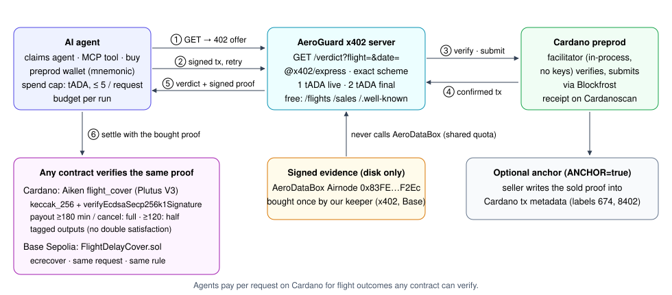

# AeroGuard on Cardano: pay-per-request flight verdicts over x402

Agents pay per request on Cardano for flight outcomes any contract can verify.



**Video:** [`video/aeroguard-cardano-full.mp4`](video/aeroguard-cardano-full.mp4) (1:57, no sound) and ten separate clips, see [`video/SHOTLIST.md`](video/SHOTLIST.md). **All changes:** [`CHANGELOG.md`](CHANGELOG.md). **Slides for the pitch:** [`../presentation/cardano/`](../presentation/cardano/).

**For judges (3 min, no funds, no keys):**

```bash
cd cardano && npm i && npm test     # 53 tests: real signed Cardano txs, x402 round trips, Aiken cover executed via UPLC
cd onchain && aiken check           # 44 tests, incl. real AeroDataBox Airnode signatures verified with Plutus builtins
```

**Paid on preprod:** 2 tADA over x402 for the final IB1314 verdict, tx [`e2ef922b…`](https://preprod.cardanoscan.io/transaction/e2ef922be71ba61da9431f1a5f56f4c56f5d61348c4945194cf390dd0acd7864); all paid requests in [EVIDENCE.md](EVIDENCE.md). Live run: `npm run qualify` (needs a Blockfrost preprod key and a
faucet-funded wallet, see below).

`GET /verdict?flight=IB1314&date=2026-10-30` answers **402** with a price on `cardano:preprod`: **1 tADA** while the
flight is live (scheduled, en route…), **2 tADA** once the proof is final (arrived or cancelled); tUSDM offered too. The agent's wallet signs a Cardano
transaction (never broadcasts it), retries with `PAYMENT-SIGNATURE`, the facilitator verifies and submits it, and the
server returns:

- `verdict`: status, scheduled/actual arrival, delay minutes, final or not (same rule as `FlightDelayCover`);
- `evidence`: the AeroDataBox Airnode's signed response (`airnode, requestHash, timestamp, data, signature`), which
  `FlightDelayCover` on Base Sepolia, any `AirnodeV2Attestation.verify`, and the Aiken validator in [`onchain/`](onchain)
  accept unchanged;
- `paidWith`: the Cardano tx hash and its Cardanoscan link.

Built on the official template stack: `@x402/express`, `@x402/core`, `@x402/cardano` 2.26.0 (`exact` scheme, Blockfrost
provider), as in [cardano-foundation/x402-cardano-demo](https://github.com/cardano-foundation/x402-cardano-demo). The
facilitator runs in the server process (no keys, no funds); set `FACILITATOR_URL` to use a hosted one.

| Endpoint | Cost | What |
|---|---|---|
| `GET /verdict?flight=&date=[&requestId=]` | 1 or 2 tADA | verdict + Airnode proof + payment receipt |
| `GET /policy?flight=&date=&holder=0x…&coverage=` | premium in tADA | buys a `FlightDelayCover` policy on Base Sepolia after the Cardano payment settles |
| `GET /orders/:tx` | free | that order: `buying` → `bought` (policy id, Basescan) or `failed` (refund due) |
| `GET /flights` | free | flights with evidence, kind and price |
| `GET /sales` | free | settled sales with Cardanoscan links (and anchor tx) |
| `GET /.well-known/x402` | free | machine-readable offer for agent discovery |

- **One payment, one answer.** A replayed payment returns the same body; it never buys a second operation. A flight
  without evidence gets a free 404, never a charge.
- **Quota-safe.** Evidence comes from disk only (`evidence/`, then `keeper/.cache/`); this service never calls the Airnode.
  It resells what the keeper already bought: `npm run import-evidence -- keeper.json` imports the keeper's published
  answers (`keeper-data` branch) after checking each signature. Today's catalog: live answers for the four policies of 30 Oct
  (IB1314, LH1816, EI357, BA955); the newest answer per request wins.
- **On-chain anchor** (`ANCHOR=true`, seller wallet needs ≥ 2 tADA from the faucet): after each sale the seller writes the sold proof into Cardano tx metadata (label
  674 message + label 8402 proof bytes), so the evidence is findable on Cardano itself.

## Run (Cardano preprod)

```bash
cd cardano && npm i            # also installs ../keeper, whose verdict code this reuses
npm run wallets                # creates cardano/.env with a buyer and a seller mnemonic, prints both addresses
# put your Blockfrost preprod project ID in cardano/.env, fund the buyer address from the faucet
npm run qualify                # preflight → start endpoint → pay → EVIDENCE.md + Cardanoscan link (one command)
```

`npm run preflight` alone checks the key's network, both wallets, the evidence and the buyer's balance, with a fix for
each failure. The same steps by hand, e.g. for the video:

```bash
npm run server                 # http://localhost:4021   (ANCHOR=true npm run server to anchor sales)
npm run buy                    # second terminal: pays, prints verdict, tx hash and Cardanoscan link, appends EVIDENCE.md
npm run agent                  # claims agent over claims.json: free catalog check, budget, pay only for final proofs
```

`npm run buy -- --flight IB1314 --date 2026-10-30` picks the flight. Spend control: tADA only, at most
`MAX_LOVELACE_PER_REQUEST` (default 5 tADA) per request; the agent also has `AGENT_BUDGET_LOVELACE` (default 10 tADA).

**MCP for LLM agents** (`npm run mcp`, stdio): tools `list_flights` (free), `get_flight_verdict` and `buy_flight_cover` (paid in tADA).
Client config: `{ "command": "node", "args": ["--env-file=cardano/.env", "cardano/src/mcp.ts"] }`.

## Buy flight cover on Base, pay the premium in tADA

With the keeper's keys (`KEEPER_PK`, `FLIGHT_COVER_ADDRESS` in the root `.env`), `npm run server:policies` also sells
policies: the 402 price is the contract's `quote(coverage)` × `LOVELACE_PER_AUSD_UNIT` (testnet demo rate 1 aUSD = 10
tADA, at least 1 tADA). **Only after the Cardano payment settles** the server runs the keeper's own purchase path (fresh
signed status proof, then `buyPolicy`) with `cardanoJobRef = keccak256("cardano:<payment tx>")`, so the Base policy names
the Cardano payment that bought it. If the purchase fails (e.g. the flight already departed), the order is marked
`refundDue`; nothing is bought without a settled payment.

```bash
npm run server:policies
npm run buy-policy -- --flight LH1234 --date 2026-11-01 --holder 0xYourAddress --coverage 500000
```

## On-chain: a Cardano contract that verifies the same proof

[`onchain/`](onchain) is an Aiken (Plutus V3) flight cover: a UTxO holding the cover amount, spendable only with an
Airnode proof that the flight is final, paying the holder by `FlightDelayCover`'s rule (cancelled or ≥ 180 min: full,
≥ 120 min: half, else back to the insurer), or reclaimed by the insurer after a deadline.

Each payout output must carry the spent policy's `OutputReference` as inline datum, so one output can never settle
two policies at once (double satisfaction).

Freshness mirrors `FlightDelayCover` (`Stale`, `FromTheFuture`, `ObservedTooEarly`): the settle transaction's whole
validity window must lie within `[signed at, signed at + max_age]` (set per policy, default 60 min), and an arrival
answer must be signed after the landing it reports. An old answer, e.g. a cancellation the airline later reversed,
cannot settle a cover.

Plutus has no `ecrecover`, so the validator stores the Airnode's compressed secp256k1 key and checks
`verifyEcdsaSecp256k1Signature(key, keccak_256(prefix ‖ keccak_256(requestHash ‖ uint256(timestamp) ‖ data)), r‖s)`.
It never parses JSON: it rebuilds the exact signed bytes from typed redeemer fields. `src/onchain.ts` is a byte-exact
model of that path; its tests verify the **real** Airnode signature with Plutus semantics and recover the key back to
`0x83FE…F2Ec`. `npm run vectors` regenerates `onchain/lib/aeroguard/vectors.ak` (then `aiken fmt`).

```bash
cd onchain && aiken check      # 44 tests: real Airnode signatures (incl. the four final landings), forgeries, freshness, time, payout rule, validator paths
aiken build                    # plutus.json
```

| | |
|---|---|
| Compiler / stdlib | Aiken v1.1.24, stdlib v2.2.0, Plutus V3 |
| Script hash | `107d68180f4399c12060b76c4869e9790aeffc9957c7ef44fb2447c7` (2,194 bytes) |
| Preprod script address | `addr_test1wqg866qcpapensfqvzmkcjrfa9us4mlun9tu0m6ylvjy03cx080wx` |
| Real Airnode signature check | ≈ 34–48k mem / 59–64M cpu; a full settlement ≈ 0.46M mem / 0.19B cpu (tx limit 14M / 10B) |

**Off-chain** (`src/cover.ts`, `npm run cover`): the insurer (seller wallet, needs a few tADA) opens a cover; anyone
settles it with the JSON body an agent bought from `/verdict`; the insurer reclaims after the deadline.

```bash
npm run cover -- open --flight IB1314 --date 2026-10-30 --holder addr_test1... --ada 5 --hours 48
npm run buy -- --flight IB1314 --date 2026-10-30 > /dev/null   # or save the /verdict body to verdict.json
npm run cover -- settle --open <openTx> --verdict verdict.json   # refused until the verdict is final
npm run cover -- reclaim --open <openTx>                         # after the deadline
```

Every build runs the validator locally with Aiken's UPLC evaluator (`@evolution-sdk/aiken-uplc`), so a transaction the
script would reject is never submitted.

**One signed answer, the same verdict on two chains, for the four policies of 30 Oct.** The keeper's signed `Arrived`
answers settled policies #1–#4 on Base; the very same signatures, checked with Plutus builtins, settle an Aiken cover the
same way, and paying the holder with them is refused (`onchain/lib/aeroguard/real_final_*_test.ak`, generated from
`evidence/`; the TS lifecycle tests build and execute each settlement transaction).

| Policy | Flight | Signed landing | Base Sepolia (`FlightDelayCover`) | Cardano (Aiken cover, same signature) |
|---|---|---|---|---|
| #1 | IB1314 | 21:00Z, 25 min early | `ClosedNoPayout` [0xf0aa5db2…](https://sepolia.basescan.org/tx/0xf0aa5db2e08a9b9aa7298c92853642b39d7ff330fe3e42cd8b441aa136246b44) | no payout, cover back to insurer |
| #2 | LH1816 | 22:06Z, 11 min late | `ClosedNoPayout` [0x5270aa58…](https://sepolia.basescan.org/tx/0x5270aa58d63db79af041e74bb40115a801381f28caca028d90c285280594c535) | no payout, cover back to insurer |
| #3 | EI357 | 21:26Z, 29 min early | `ClosedNoPayout` [0x5a5e4fc7…](https://sepolia.basescan.org/tx/0x5a5e4fc750464b0f4043aa2318da55705ae0eb94603adf17d417068de4f2ff9a) | no payout, cover back to insurer |
| #4 | BA955 | 21:47Z, 3 min early | `ClosedNoPayout` [0x973e29d8…](https://sepolia.basescan.org/tx/0x973e29d8195ce6bfe7bde0b749b308cfe1e8200e2465c849810a0a01dd01c7ee) | no payout, cover back to insurer |

Real Airnode signatures in the Aiken tests: the IB1314 pre-departure status and a live arrival answer (`EnRoute`, with
`actual`), both verify on-chain-style and both are refused for settlement (`NotFinal`), exactly like `FlightDelayCover`;
relabelling the en-route answer as `Arrived` breaks the signature. Final-outcome paths use a public test key until the
keeper buys a final answer; then `npm run vectors` writes `real_final_test.ak` and the TS lifecycle test settles a cover
on the real signature automatically.

## Test without network or funds

```bash
npm test
```

53 tests. The buyer signs real Cardano transactions with the SDK's reference signer and the server's facilitator
verifies and submits them; the Aiken cover's transactions are built and **executed** with Aiken's UPLC evaluator
(PlutusV3 cost model). Only Blockfrost is a local fixture (as in the official demo's tests). Covers the 402 offer,
refusals, discovery, paid verdicts, replay, sales log, anchor transaction, claims agent, MCP, preflight, the whole
`qualify` run as a separate process, the Plutus model, and the cover lifecycle (full/half/none/cancel, edited proof,
wrong signer, non-final live proof, reclaim before/after deadline).
